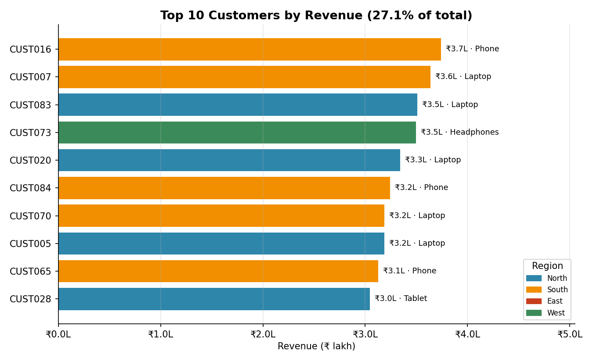
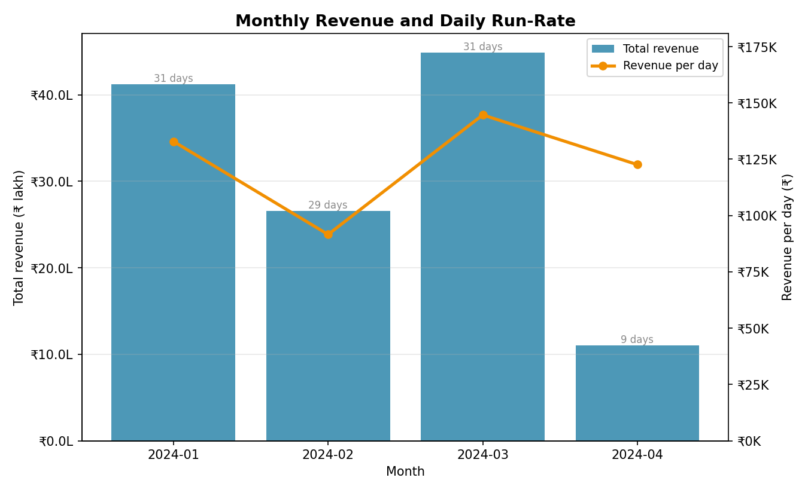
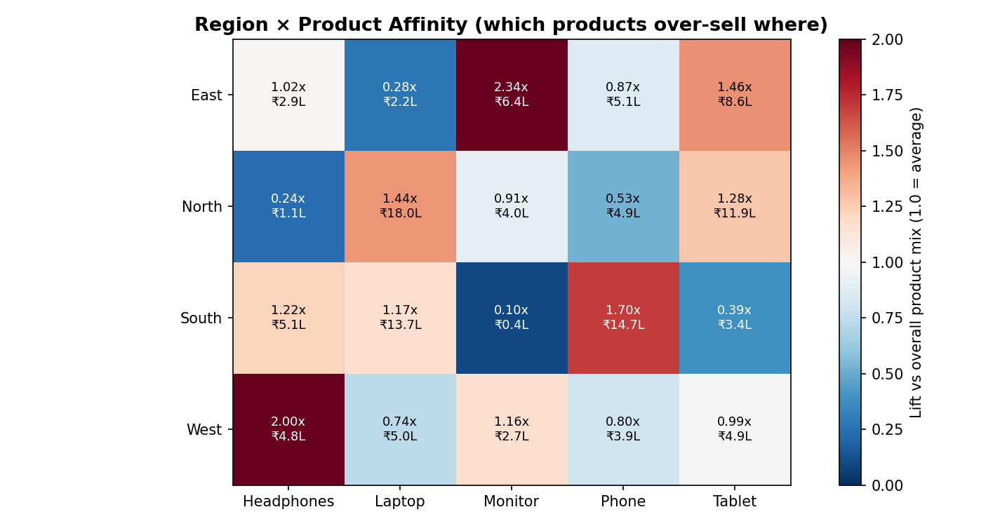
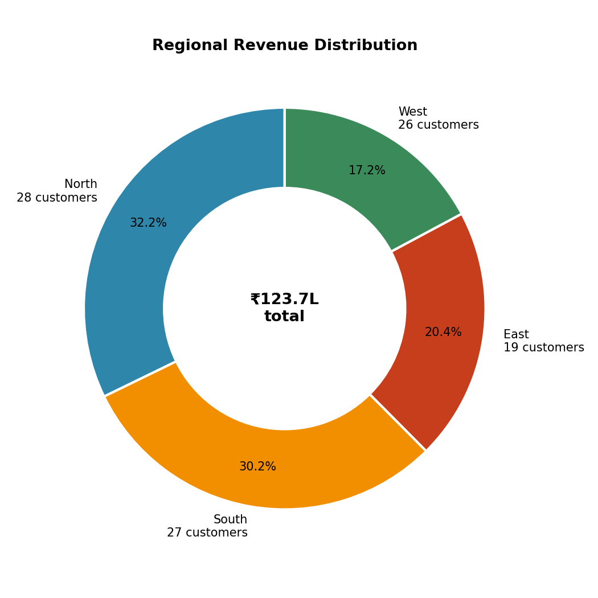
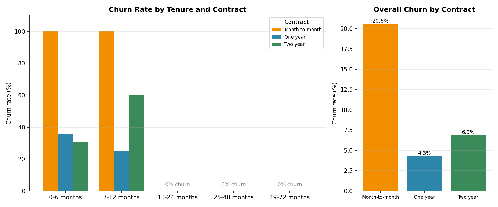
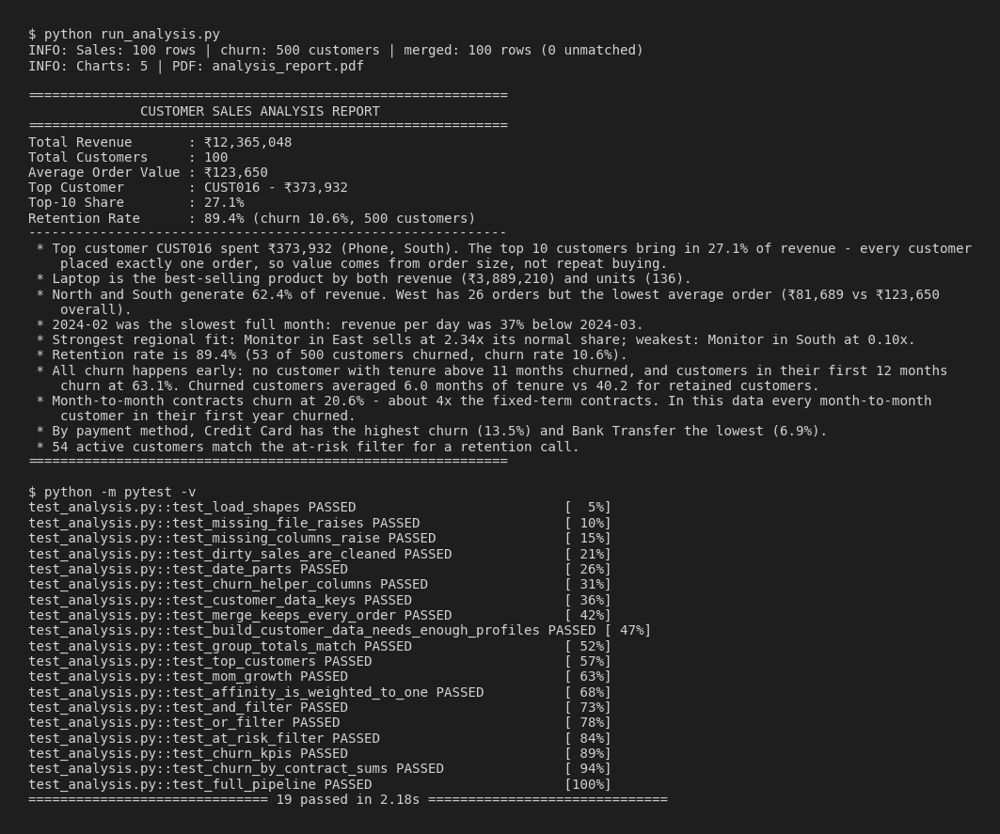

# Week 5 – Customer Sales Analysis

Advanced data manipulation with **pandas**: grouping and aggregation, multi-condition filtering, string and datetime operations, merging, and pivot tables. The project finds the most valuable customers, regional and monthly sales patterns, the best-selling products and the customer retention rate, then turns them into business recommendations.

## Project Overview

**Business questions**

1. Who are our most valuable customers?
2. What products sell best together? *(see the cross-selling note below)*
3. Which regions have the highest sales?
4. What are the seasonal trends?
5. How can we improve customer retention?

**Headline results**

| Metric | Value |
|---|---|
| Total revenue | ₹1,23,65,048 from 100 orders (Jan 1 – Apr 9, 2024) |
| Average order value | ₹1,23,650 |
| Top customer | CUST016 – ₹3,73,932 (Phone, South) |
| Top-10 customers' share of revenue | 27.1% |
| Best-selling product | Laptop – ₹38,89,210 and 136 units (No. 1 on both) |
| Top region | North – 32.2% of revenue (North + South = 62.4%) |
| Slowest month | Feb 2024 – revenue per day 37% below March |
| Retention rate (500 customers) | **89.4%** (53 churned, churn rate 10.6%) |
| Churn by contract | Month-to-month 20.6% · One year 4.3% · Two year 6.9% |
| When churn happens | No customer with more than 11 months' tenure churned |

The full write-up, with an executive summary, is in [`analysis_report.pdf`](analysis_report.pdf).

### About the data – please read

| File | What it is |
|---|---|
| `sales_data.csv` | 100 orders provided for the task. Each `Customer_ID` (CUST001–CUST100) appears **once**. |
| `data/customer_churn.csv` | 500 customer profiles with churn flag provided for the task (C00001–C00500). |
| `customer_data.csv` | **Created by this project.** The two files above share **no customer key**, so to practise merging, the first 100 churn profiles are linked to CUST001–CUST100 **in order** (`Source_Profile_ID` shows the original ID). |

- Findings that use the merged table are **illustrative only** and are labelled that way.
- Retention and churn findings use the full 500-customer file and are **real**.
- **Cross-selling:** every customer has a single order, so products bought together cannot be measured. Instead, the project measures **region × product lift**: where each product sells more or less than the overall mix.

## Setup Instructions

1. Install Python 3.9 or newer.
2. Clone and enter the project:
   ```bash
   git clone https://github.com/surajsuman23/week5-customer-sales-analysis.git
   cd week5-customer-sales-analysis
   ```
3. (Optional) create a virtual environment:
   ```bash
   python -m venv venv
   source venv/bin/activate        # Windows: venv\Scripts\activate
   ```
4. Install dependencies:
   ```bash
   pip install -r requirements.txt
   ```
5. Run the full pipeline. This regenerates the charts, `report_tables/` and `analysis_report.pdf`:
   ```bash
   python run_analysis.py
   ```
6. Or explore step by step in the notebook:
   ```bash
   jupyter notebook customer_analysis.ipynb
   ```
7. Run the tests:
   ```bash
   python -m pytest -v
   ```

All paths are relative to the project folder, so it runs the same on Windows, macOS and Linux.

## Project Structure

```
week5-customer-sales-analysis/
├── customer_analysis.ipynb     # main notebook, Day 1–7 walkthrough (executed, outputs saved)
├── sales_data.csv              # order data (provided)
├── customer_data.csv           # customer profiles linked to sales (simulated link, see above)
├── analysis_report.pdf         # 7-page report: executive summary, analysis, recommendations
├── requirements.txt
├── run_analysis.py             # one-command pipeline (CLI)
├── README.md
├── data/
│   └── customer_churn.csv      # 500-customer churn data (provided)
├── src/
│   ├── data_prep.py            # load, validate, clean, string/date operations, build + merge
│   ├── analysis.py             # aggregations, filters, pivot tables, churn metrics
│   ├── charts.py               # 5 matplotlib charts
│   ├── insights.py             # data-driven insight and recommendation text
│   └── pdf_report.py           # ReportLab PDF builder
├── visualizations/             # generated PNG charts
├── report_tables/              # generated CSV tables (open in Excel)
├── screenshots/
│   └── terminal_output.png     # pipeline run + test results
└── tests/
    └── test_analysis.py        # 19 pytest tests
```

### Code structure

| Module | Key functions |
|---|---|
| `src/data_prep.py` | `load_csv`, `clean_sales`, `add_date_parts`, `clean_churn`, `build_customer_data`, `merge_sales_customers` |
| `src/analysis.py` | `customer_value`, `region_summary`, `monthly_summary`, `product_summary`, `weekday_summary`, `add_order_share_within_region`, `high_value_orders`, `laptop_or_bulk_orders`, `weekend_large_orders`, `region_product_pivot`, `month_product_units_pivot`, `region_month_orders_pivot`, `region_product_affinity`, `churn_kpis`, `churn_by`, `contract_tenure_pivot`, `at_risk_customers`, `run_all` |
| `run_analysis.py` | `load_and_prepare`, `run`. Wires everything together and prints the summary |

## Visual Documentation

| | |
|---|---|
|  |  |
|  |  |



**Program run and test results**



## Technical Details – how each requirement is met

| Requirement | Where / how |
|---|---|
| Use pandas for all data manipulation | All loading, cleaning, aggregation and reshaping is done in pandas (`src/`) |
| **≥ 3 aggregation types** | Named `groupby().agg()` (sum, mean, count, nunique, max) per region, month, product and weekday; `groupby().transform('sum')` for each order's share of its region; `pct_change()` for month-on-month growth; `rank()` for product ranking; `cumsum()` for cumulative customer share |
| Multi-condition filtering | AND: orders ≥ ₹2,00,000 **and** region in North/South (14 orders). OR: Laptop **or** ≥ 8 units (36 orders). NOT: weekend **and** > ₹1,50,000 **and not** Headphones (10). AND/OR: active **and** (tenure ≤ 12 **or** month-to-month with tenure ≤ 24), giving 54 at-risk customers |
| String operations | `.str.strip()`, `.str.title()`, `.str.upper()`, `.str.capitalize()`, `.str.replace()` to standardise text and IDs; `.str.contains()` to flag fixed-term contracts and automatic payment methods |
| Datetime | `.dt.year`, `.dt.to_period('M')`, `.dt.month_name()`, `.dt.day`, `.dt.day_name()`, `.dt.dayofweek` (weekend flag), `.dt.isocalendar().week` |
| Merging / joining | `customer_data.csv` left-joined onto orders with `validate="many_to_one"`, `indicator=True` and a row-count check (100 → 100 rows, 0 unmatched) |
| Pivot tables | Region × Product revenue (with totals); Month × Product units; Region × Month order count and mean; Tenure band × Contract churn rate; Region × Product lift |
| Professional visualisations | 5 chart types: horizontal bar, bar + line combo, heatmap, grouped bar, donut |
| Customer lifetime value | Revenue per customer over the period (each customer = 1 order); top-10 share and cumulative share |
| Retention rate | 1 − churn rate on the 500-customer file, broken down by contract, tenure band, payment method and senior status |
| Error handling | Custom `DataValidationError` for missing columns, empty files or no valid rows; `errors="coerce"` for bad dates and numbers; duplicate and invalid-row removal; `Total_Sales` recomputed when it doesn't match `Quantity × Price`; merge validation |

## Testing Evidence

`tests/test_analysis.py` has **19 tests**, all passing (see the screenshot above):

- **Loading:** dataset shapes, missing file, missing columns
- **Cleaning:** a deliberately dirty CSV (spaces, mixed case, duplicate, missing total, bad date, negative quantity), date parts, churn helper columns
- **Merge:** unique keys in `customer_data.csv`, no orders lost or unmatched, an error when there aren't enough profiles
- **Aggregations:** region, month, product and weekday totals all equal total revenue; pivot grand total; top customers; month-on-month growth; affinity weights
- **Filters:** AND, OR and at-risk filters return only matching rows
- **Churn:** 53 churned, 10.6% churn rate, 89.4% retention, contract breakdown sums to 500
- **End-to-end:** the pipeline creates 5 charts, the CSV tables and the PDF

## Key Insights

1. **Customer value comes from order size, not loyalty.** The top 10 customers bring in 27.1% of revenue, and nobody bought twice.
2. **Laptop leads on both revenue and units.** Headphones and Monitors are the two smallest categories.
3. **North and South bring in 62.4% of revenue.** West has 26 orders but the lowest average order (₹81,689 vs ₹1,23,650).
4. **February dipped.** Revenue per day was 37% below March, the best month.
5. **Regional fit:** Monitors sell at 2.34× their usual share in the East but only 0.10× in the South. Headphones sell at 2.00× in the West.
6. **All churn happens in the first year.** Customers with 12 months' tenure or less churn at 63.1%. Above 11 months, nobody churned.
7. **Contract type matters.** Month-to-month churn is 20.6%, against 4.3% for one-year contracts. Every month-to-month customer in their first year churned.

## Business Recommendations

- Run an onboarding and retention programme for the **first 12 months**.
- Offer incentives to move month-to-month customers onto **one-year contracts**.
- Prioritise **Laptop** stock and promotion.
- Push Monitors in the East and test bundles in the West to lift its average order value.
- Start a VIP programme for the top 10 customers and track repeat purchases.
- Use one shared customer ID across sales and CRM data so real customer-level merges are possible.

## Limitations

- Only 100 orders over about 3 months, and each customer appears once, so there is no repeat-purchase or basket analysis.
- The sales ↔ customer link is simulated (no shared key in the source files).
- In the churn file, 20.6% of customers have `TotalCharges` below half of `MonthlyCharges × Tenure`. That column was therefore not used for lifetime-value estimates.
- There is no cost data, so this is a revenue analysis, not a profit analysis.

## What I Learned

- Writing reusable data functions in modules and calling them from a notebook
- Using named aggregations, `transform`, `pct_change` and `rank` together
- Combining AND / OR / NOT conditions with boolean masks
- Validating a merge, and being honest when two datasets can't really be joined
- Normalising a partial month (revenue per day) before comparing trends
- Building a PDF report automatically with ReportLab
